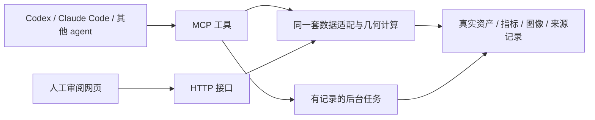

# AlphaMotion agent 工具链

交付形态是 **MCP 服务 + 共享后端 + 人工审阅网页**。Agent 通过工具调用读取数据、执行任务、查看指标和真实图像；网页供人选择样本、交互播放、审阅和作出人工决定。



## 第一版能力

| 能力 | 工具 | 状态 |
|---|---|---|
| 能力与环境查询 | `toolchain_status`、`workflow_list` | 已实现 |
| 动作与来源 | `motion_catalog`、`motion_inspect` | 复用网页 FactoryService |
| 指标检查 | `motion_frame_metrics` | 1–64 帧；源 hash 绑定；全量采样表面点 |
| 视觉检查 | `motion_visualize` | 原生 PNG；指定帧、四视角、原始/修正对照、人体/表面点 |
| 结果和视频检查 | `evidence_list`、`evidence_read`、`video_inspect` | 结构化结果、原生图像、视频指定时刻抽帧 |
| 后台任务 | `workflow_plan`、`workflow_submit`、`job_status`、`job_logs`、`job_artifacts` | 独立输出、幂等提交、重连查询、超时和实际退出状态 |
| Agent 观察记录 | `agent_note` | 单独追加；不进入人工通过率或人工判决日志 |
| 基础工程验证 | `foundation_smoke`、`foundation_tests` 工作流 | 已接入现有 CPU 验证入口 |
| 重定向、下一轮训练/评估、动力学仿真 | 工作流注册表 | 尚未接入；明确返回缺口，不能当成已可运行 |

下一阶段将现有转换、UMR 重定向、训练和评估入口适配成参数明确、输出隔离的工作流。历史六组训练脚本使用固定目录，不能直接充当下一轮训练任务。注册项必须包含输入 schema、固定 argv、代码和输入校验、资源预算、退出与产物契约；MCP 不提供任意 shell 执行接口。

## 连接

ArenaLabs：`/home/arenalabs/motion_audit_web/scripts/mcp_stdio.sh`。
该启动器使用独立 `.mcp-venv`，不升级网页或训练环境。MCP 通过 SSH 的 stdin/stdout 通信，不依赖网页服务和浏览器，也不开放公网端口。

通用 stdio 客户端的进程配置：

```json
{
  "mcpServers": {
    "alphamotion": {
      "command": "ssh",
      "args": ["-T", "-o", "BatchMode=yes", "-o", "ConnectTimeout=12", "-o", "ServerAliveInterval=15", "-o", "ServerAliveCountMax=2", "arenalabs", "/home/arenalabs/motion_audit_web/scripts/mcp_stdio.sh"]
    }
  }
}
```

Codex 使用项目 `.codex/config.toml` 中的 `[mcp_servers.alphamotion]`；stdio 的 `command` 和 `args` 相同，另设 `startup_timeout_sec = 40`、`tool_timeout_sec = 180`。项目配置需要项目受信任，已有会话可能需要重新连接后发现工具。[官方接入说明](https://learn.chatgpt.com/docs/extend/mcp?surface=cli)

## 调用流程

1. `toolchain_status()` / `workflow_list()` 确认哪些能力已接通。
2. `motion_catalog()` → `motion_inspect(key)` 取得当前 hash、帧数、来源和警告。
3. `motion_frame_metrics(key, sha256, start, count)` 核对指标。
4. `motion_visualize(key, sha256, frames, mode="compare")` 直接给模型返回图像和逐帧证据。
5. `workflow_plan("foundation_smoke", {})` 取得精确执行计划，再明确调用 `workflow_submit(plan_id, idempotency_key)`。
6. 用任务 ID 查询状态、增量日志和产物。MCP 客户端关闭不会丢失后台任务记录。
7. Agent 可通过 `agent_note` 留下观察，人工最终判断继续使用网页。

计划有效期一小时。提交前和执行前核对配置、代码及输入 hash。任务执行槽忙时返回失败，不另起隐形无限队列；无自动重试或训练恢复。下载由原唯一下载队列负责，MCP 不启动或停止它。容量保护保守预留整个固定下载计划以及 16 GiB 余量，再加任务输出预算。归档解压需要额外空间估算。

## 证据边界

预览使用与网页相同的编译 MJCF 网格、正向运动学和来源校验。图像是 CPU 离线渲染，不能据此宣称实时性能、动力学仿真或真机验证。原始姿态不复用修正后接触标签作为原始标签。地面穿透指标基于采样表面点，不能代替连续网格碰撞检查。物体距离保留原算法范围说明。多栏相机使用共同世界范围，不对身体位置做独立对齐。

图像内容使用 MCP 原生 image block；视频通过原生图像抽帧交给模型观察。完整视频保留为证据文件，播放器能力由客户端决定。[MCP 图像协议实现说明](https://py.sdk.modelcontextprotocol.io/servers/media/)

## 验证入口

```bash
.mcp-venv/bin/python -m pytest tests/test_mcp.py -q
.mcp-venv/bin/python scripts/smoke_mcp_client.py --output qa/mcp-live --submit-smoke
```

第二条会实际执行一次已接入的 CPU 基础工程验证，不启动训练。测试回执、图像和真实任务状态保存在指定目录。测试模式的合成样本与真实资产验收证据分开保存。
